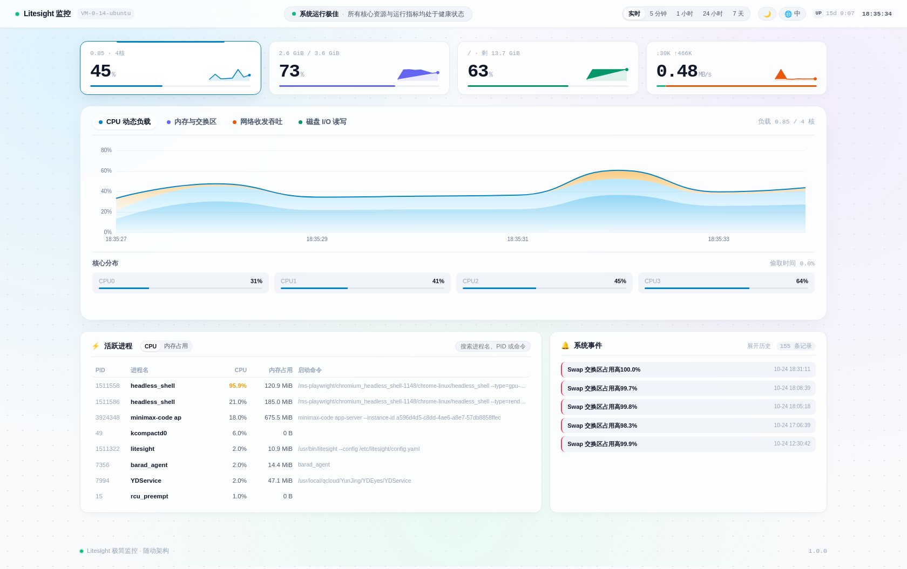
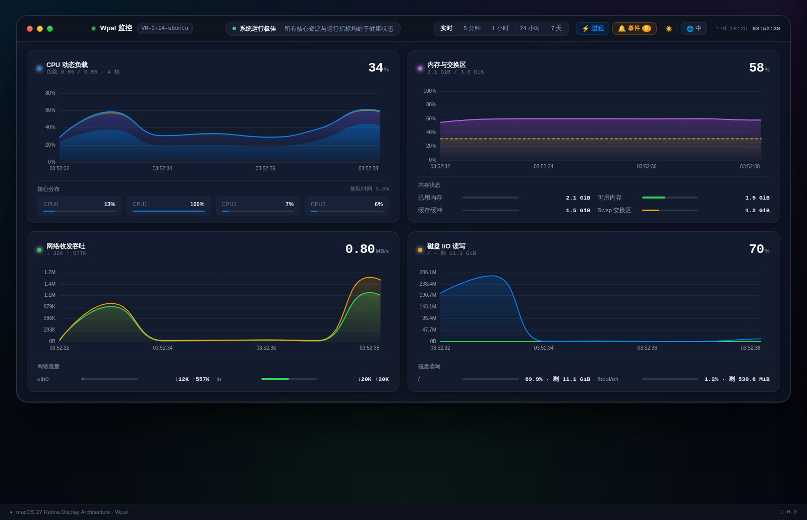
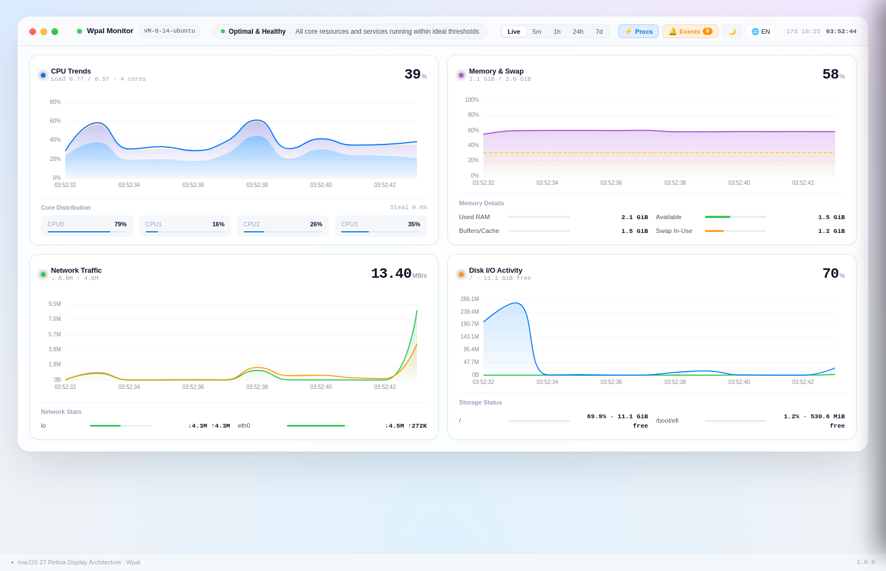
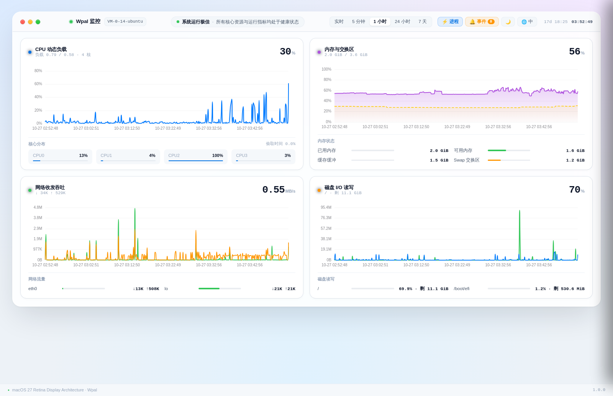

<div align="center">

# Wpal（微光）

**轻量级、跨平台的服务器资源监控 —— 单个静态二进制，零运行时依赖。**

[](https://go.dev)
[](LICENSE)
[](https://github.com/xuhongteng/wpal/actions/workflows/ci.yml)
[](https://goreportcard.com/report/github.com/xuhongteng/wpal)
[](SECURITY.md)

[中文](README.md) · [English](README.en.md)

</div>

---

Wpal 是一个服务器监控看板，交付形态是**一个静态二进制文件**。
把它拷到任意 Linux / macOS / Windows 机器上直接跑，浏览器里就有实时看板——
不需要 Python、不需要 Node、不需要容器运行时、不需要数据库。

| | |
|---|---|
| **二进制体积** | 7 MB（全平台，静态链接，无 cgo） |
| **空闲内存** | 约 11.5 MB RSS（实测） |
| **依赖** | 无——前端已嵌入二进制 |
| **存储** | 固定大小的环形文件，磁盘占用不会增长 |
| **刷新** | 每秒采样一次，WebSocket 推送 |

---

## 特性

- **实时看板** —— CPU（含每核）、内存、Swap、磁盘、网络、进程排行
- **WebSocket 推送** —— 全局只有一个采样循环，所有客户端共享同一帧数据
- **阈值告警** —— 6 条内置规则，看板内标红 + 事件流记录
- **历史回看** —— 默认留存 7 天，环形文件定长不增长；5 分钟到 7 天任意档位回放
- **中英双语** —— 默认中文，一键切英文
- **零配置** —— 开箱即用，不写配置文件也能跑
- **随处可跑** —— 裸机 / systemd / launchd / Windows 服务 / Docker / `curl | sh`

---

## 截图

| 实时视图 | 暗色模式 | 英文界面 | 历史回看 |
|---|---|---|---|
|  |  |  |  |

---

## 安装

### Linux

```bash
curl -fsSL https://raw.githubusercontent.com/xuhongteng/wpal/main/packaging/scripts/install.sh | sh
```

或从发布页下载压缩包：

```bash
tar -xzf wpal_1.0.0_linux_amd64.tar.gz
sudo install -m 0755 wpal /usr/local/bin/wpal
wpal
```

随后访问 <http://127.0.0.1:8891/>。

> 服务默认只监听回环地址。需要对外暴露时用 nginx / Caddy / IIS 反代，并在那里做 TLS。

### macOS

```bash
brew install wpal
wpal
```

### Windows

```powershell
winget install wpal
```

或下载 `wpal_1.0.0_windows_amd64.zip` 后运行 `wpal.exe`。

### Docker

```bash
docker run -d --name wpal \
  --pid host --network host \
  -v wpal-data:/data \
  -v /:/host/root:ro \
  ghcr.io/xuhongteng/wpal
```

`--pid host` 与 `--network host` 让容器能看到**宿主机**的进程与网卡；
只读挂载 `/` 则让它读到真实的挂载表与分区容量。

### 安装包

每个[发布](https://github.com/xuhongteng/wpal/releases)都附带
`.deb`、`.rpm` 以及 `.tar.gz`/`.zip`，同时提供 SHA256 校验和与 SBOM。

Windows 的 MSI 安装包同样受支持——WiX 模板在 `packaging/windows/`，
在 `.goreleaser.yml` 中以注释形式保留，需要 goreleaser ≥ 2.8 时启用
（这样配置本身仍兼容 goreleaser 2.7）。

---

## 配置

Wpal 开箱即用。需要定制时，在 `/etc/wpal/config.yaml`（Linux）
放一份 YAML，或用 `--config` 指定：

```yaml
server:
  listen: "127.0.0.1:8891"
  base_path: ""            # 部署在子路径下时填写，例如 /monitor

collect:
  interval: 1s
  include_virtual_nics: false
  top_processes: 15
  host_root: ""            # 容器场景：指向挂载进来的宿主根目录

history:
  enabled: true
  retain: 168h            # 7 天
  persist_interval: 10s
  data_dir: "/var/lib/wpal"

alerts:
  cpu:    { warn: 80,  crit: 93, hold: 30s, recover: 20s }
  memory: { warn: 85,  crit: 94, hold: 20s, recover: 20s }
  swap:   { warn: 50,  crit: 85, hold: 60s, recover: 30s }
  disk:   { warn: 80,  crit: 90, hold: 60s, recover: 60s }
  inode:  { warn: 85,  crit: 95, hold: 60s, recover: 60s }
  load:   { warn: 1.5, crit: 3.0, hold: 45s, recover: 30s }
```

所有配置项也可用环境变量（`WPAL_LISTEN`、`WPAL_DATA_DIR` …）
或命令行参数覆盖，详见 [docs/CONFIGURATION.md](docs/CONFIGURATION.md)。

---

## 监控指标

| 维度 | 指标 |
|---|---|
| CPU | 总占用、每核占用、用户/系统/iowait/steal 分解、load 1/5/15、上下文切换速率、频率 |
| 内存 | 总量/已用/可用/空闲/缓存/缓冲/共享、Swap 使用 |
| 磁盘 | 各挂载点容量与 inode 使用率、逐设备读写吞吐、IOPS、繁忙率 |
| 网络 | 逐网卡上下行速率与包速率、错误包、丢包、TCP 连接状态分布 |
| 进程 | CPU / 内存 Top 榜，含 PID、用户、线程数与完整命令行 |
| 系统 | 运行时长、进程数、线程数、文件句柄占用、熵池 |

### 平台支持

| 指标 | Linux | macOS | Windows |
|---|:---:|:---:|:---:|
| CPU / 内存 / 负载 | ✅ | ✅ | ✅ |
| 每核 CPU | ✅ | ✅ | ✅ |
| 磁盘容量与 IO | ✅ | ✅ | ⚠️ 依赖 PDH 计数器 |
| 网络吞吐与 TCP 状态 | ✅ | ✅ | ✅ |
| inode 使用率 | ✅ | 不适用 | 不适用 |
| steal time | ✅ | 不适用 | 不适用 |

平台不支持的指标以 `0` 呈现，不会导致整次采集失败。

---

## HTTP 接口

| 路径 | 说明 |
|---|---|
| `GET /api/health` | 健康检查 |
| `GET /api/snapshot` | 当前快照（走缓存，不会重新采集） |
| `GET /api/history?range=1h` | 历史序列（`5m`/`1h`/`6h`/`24h`/`7d`） |
| `GET /api/events?limit=100` | 告警事件流，最新在前 |
| `GET /api/procs?sort=mem` | 按需拉取进程明细 |
| `WS /ws/stream` | 实时帧，每秒一帧 |

---

## 从源码构建

```bash
git clone https://github.com/xuhongteng/wpal.git
cd wpal
make build      # 产出 ./bin/wpal
make test       # 单元测试
make cross      # 交叉编译全部目标平台
make release    # goreleaser：全平台包 + 校验和 + SBOM
```

需要 Go 1.23 及以上。`make help` 可查看全部目标。

---

## 参与贡献

欢迎贡献代码，请先阅读 [CONTRIBUTING.md](CONTRIBUTING.md)。
参与即表示同意遵守 [行为准则](CODE_OF_CONDUCT.md)。

## 安全

请私下报告安全问题，流程见 [SECURITY.md](SECURITY.md)。

## 许可证

[Apache License 2.0](LICENSE) © Wpal Contributors
